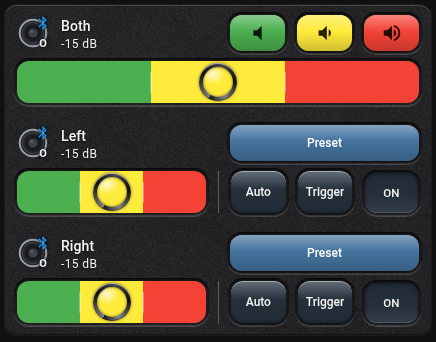

# SVS Subwoofer card

A dashboard card and three tile features for SVS subwoofers in Home Assistant, using the [SVS Subwoofer integration](https://github.com/dangerouslaser/svs-subwoofer-ha). The card began as part of [GizmoGoody's fork](https://github.com/GizmoGoody/svs-subwoofer-ha) of that integration and moved here so the integration can stay focused on the subwoofers themselves.



The card needs the SVS Subwoofer integration, version 1.10.0 or later (the version that added subwoofer groups).

## Install

Home Assistant 2026.11 and later include the Marketplace, which replaces HACS. The card needs a Home Assistant version with the Marketplace, or HACS on an older one.

1. Go to **Settings** → **Marketplace**. On the first visit, select **I understand the risks and agree**.
2. In the upper-right corner, select **Add from link**, enter `GizmoGoody/svs-subwoofer-card` under **GitHub link**, and select **Add**. If asked for the type, choose the dashboard type.
3. Open **SVS Subwoofer card** and select **Install**, then **Install** again in the dialog.
4. Reload the browser page (in the Companion app, pull down to refresh).

The Marketplace adds the card to **Settings** → **Dashboards** → **Resources** for you.

Adding a repository from a link needs a connection to GitHub, which the Marketplace asks for the first time. With HACS on an older Home Assistant, use ⋮ → **Custom repositories**, add the same address with the type **Dashboard**, then select **Download**.

If you used the card that was built into the fork of the integration, remove its old resource at `/svs_subwoofer/svs-subwoofer-card.js` from **Settings** → **Dashboards** → **Resources** once you have installed this one.

## Tile features

These add controls to any tile card whose entity belongs to an SVS subwoofer or subwoofer group. Edit a tile card, open **Features**, and add them. Each one finds its entity on the same device, so on a subwoofer group it controls the group.

| Feature | What it does |
|---------|--------------|
| **SVS Subwoofer presets** | One button per preset, lit in that preset's color while it is active. Selecting a button always loads that preset, even the one that is already shown. **Style**: **Buttons** (`presets_buttons`, one per preset) or **Cycle button** (`presets_cycle`, one button showing the active preset; each tap loads the next). Presets appear in the subwoofer's slot order until you reorder them; you can also choose which appear, and each preset's color and icon. Presets named LOW, MEDIUM, and HIGH start as green, yellow, and red, with volume icons. |
| **SVS Subwoofer volume** | A volume slider. **Slider from** and **Slider to** set its range (the full −60 to 0 dB by default), so the volumes you actually use get the whole width of the slider; the driver's size follows the same range. Turn on **Volume thresholds** to split it into three ranges, each with its own color: the track shows the ranges faintly, and the filled part takes the color of the range it ends in. |
| **SVS Subwoofer standby mode** | The standby mode as a row of buttons, styled like the preset buttons. |

All three take their height, corners, and colors from your theme.

## SVS Subwoofer card

Edit a dashboard, select **Add card**, and search for **SVS Subwoofer**. The card is Home Assistant's tile card: every tile card option works the same way and appears in the same editor. Choose the subwoofer's or group's **Volume** entity, so the driver's size follows it. **State content** can also show the subwoofer's **Preset** and **Standby mode** next to the volume. Below the tile card's options, the **SVS Subwoofer** section adds:

- **Finish**: None (your theme's own card), Premium Black Ash, Black Oak Real Wood Veneer, Piano Gloss Black, Piano Gloss White, Fabric (a dark speaker cloth), or Grille (a perforated metal speaker grille).
- **Randomize** draws a new grain (the wood finishes) or new reflections (the gloss finishes, Fabric, and Grille).
- **Finish extent**: **Card**, or **Container**. In a `custom:expander-card`, choose **Container** on the header card and on each card inside: the header draws the finish across the whole expander card, and the cards inside let it show through, so they read as one card.
- **Features style** (with a finish), the same option with the same values as on The Lampster card:
  - **Match style**: the controls sit on the finish, and it shows through them.
  - **Flat**: each control sits on a patch of the finish's base color, without grain or reflections.
  - **Console**: each control sits in a channel pressed into the panel. The preset and standby buttons are keys that press in (the active one stays pressed), and Home Assistant's own toggles become a slide.
- **Bluetooth badge**: the connection, shown on the driver (the default), only when the subwoofer is not connected, or hidden. On a group in the panel card, it shows the group's subwoofers together: all, some, or none connected.
- **Tap to connect**: a tap on the driver disconnects a connected subwoofer and reconnects one that is not connected. On a group in the panel card, it disconnects every member subwoofer when all are connected, and otherwise reconnects those that are not. Set **Icon tap behavior** (under Interactions) to use the tap for something else.
- **Driver ring**: a ring around the driver in the active preset's color, or the volume threshold's color.
- **Standby mode badge**: a letter on the driver for the standby mode: A (Auto), O (On), or T (Trigger). On a group in the panel card whose subwoofers' modes differ, M (Mixed).
- **Shake when the volume or preset changes**: the driver shakes while the volume slider moves and briefly when a preset loads, harder at a higher volume. It stays still for anyone who has reduced motion turned on.

In place of the tile card's icon, the card shows a subwoofer driver. Its size follows the volume.

```yaml
type: custom:svs-subwoofer-card
entity: number.subwoofer_both_volume
finish: black_ash         # none, black_ash, black_oak, gloss_black, gloss_white, fabric, grille
features_style: console   # match, flat or console
pattern: 4242             # the grain or reflection pattern (Randomize sets it)
finish_extent: card       # card or container
bluetooth: show           # show, disconnected or off
driver_ring: true
standby_badge: true
vibration: true
state_content:
  - state
  - preset
features:
  - type: custom:svs-subwoofer-presets
  - type: custom:svs-subwoofer-volume
    volume_thresholds:
      - below: -30
        color: green
      - below: -15
        color: yellow
      - color: red
  - type: custom:svs-subwoofer-standby
features_position: inline
```

## SVS Subwoofer panel card

The panel card (a prototype) is the SVS Subwoofer card for a subwoofer or group, with its **Member subwoofers** below it, on one surface: the finish covers the whole panel. Search for **SVS Subwoofer panel** when adding a card. Each member subwoofer is an SVS Subwoofer card of its own, with its own name, state content and features.

The editor shows the main subwoofer's tile card options first, then the **SVS Subwoofer** section, then the **Member subwoofers** section, one numbered tab each. With member subwoofers, set the main card's entity to their group subwoofer.

When the card is for a group and its subwoofers disagree, the group itself reports Unknown, so the card shows its member subwoofers instead: the state content shows the range of their volumes (for example -20 to -12 dB) and their presets and standby modes (LOW / HIGH), and the standby badge shows M. The volume slider spans their volumes, and dragging it moves every subwoofer by the same amount, so the differences between them stay as they were.

```yaml
type: custom:svs-subwoofer-panel-card
entity: number.subwoofer_both_volume
finish: fabric
members:
  - entity: number.subwoofer_left_volume
    features:
      - type: custom:svs-subwoofer-volume
    features_position: inline
  - entity: number.subwoofer_right_volume
    features:
      - type: custom:svs-subwoofer-volume
    features_position: inline
members_toggle: true      # a tap on the card shows or hides the member subwoofers
members_open: false       # the member subwoofers are hidden when the dashboard loads
```

## Troubleshooting

### The card shows "Custom element does not exist"

- Check that **Settings** → **Dashboards** → **Resources** lists the card as a JavaScript module. The Marketplace adds it when you install the card.
- Reload the browser page once. A dashboard opened before the card was available can keep showing the error until then.
- If your dashboard resources are defined in YAML (`lovelace:` `resource_mode: yaml`), the Marketplace cannot add the resource. Add it yourself:

```yaml
lovelace:
  resources:
    - url: /hacsfiles/svs-subwoofer-card/svs-subwoofer-card.js
      type: module
```

## Development

The card's source is `src/svs-subwoofer-card.js`. Rollup bundles it with the shared [console badge](https://github.com/GizmoGoody/card-badge) into `dist/svs-subwoofer-card.js` (`npm ci`, then `npm run build`). Each GitHub release gets the built file attached, and the Marketplace installs it from there.

The card is tested in Home Assistant's real frontend, with the integration's fake subwoofers (two subwoofers and a group of both), on GitHub for every push. `tests/ui/` holds the tests: the workflow checks out the integration at a pinned release, copies the tests into its `tests` folder, and runs them in headless Chrome. Screenshots of every finish, in the light and the dark scheme, are kept with each run.

## License

MIT, see [LICENSE](LICENSE).
